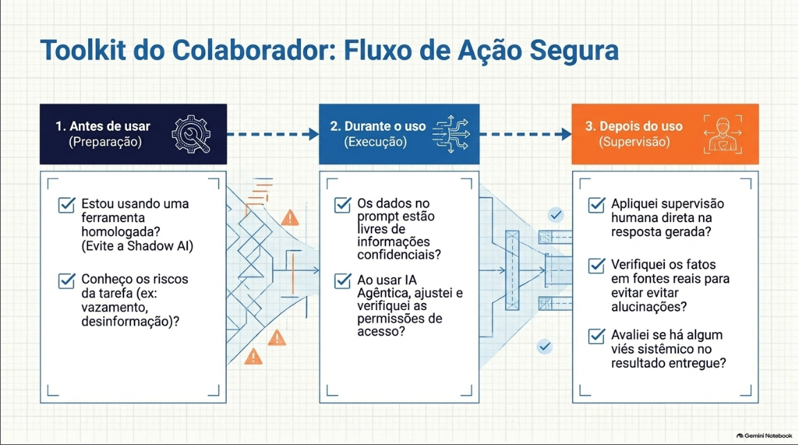
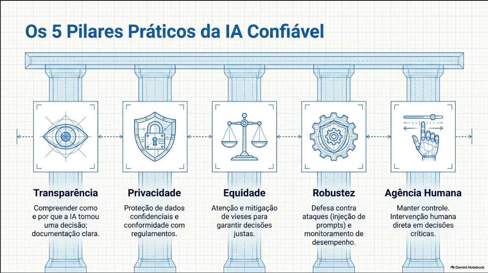

# IA Responsável — Caderno Temático com NotebookLM

## 📌 Sobre o projeto

Este projeto apresenta um Caderno Temático sobre Inteligência Artificial Responsável, desenvolvido com o apoio do NotebookLM a partir da curadoria e análise de fontes abertas.

## 🎯 Contexto e objetivos

O avanço da Inteligência Artificial trouxe novas possibilidades, mas também riscos relacionados à privacidade, segurança, vieses, transparência e confiabilidade dos sistemas.

Objetivo geral: compreender os princípios da Inteligência Artificial Responsável e identificar os principais cuidados que devem ser considerados no desenvolvimento e uso de sistemas de IA, conscientizando sobre seus riscos, limitações e impactos.

Objetivos específicos:

- Compreender o conceito de IA Responsável;
- Identificar seus principais riscos e desafios;
- Conhecer boas práticas para o uso consciente de IA;
- Desenvolver um material educativo utilizando o NotebookLM.

## 🔎 Aspectos estudados

O estudo foi organizado em cinco aspectos principais:

- Privacidade e proteção de dados
- Viés e discriminação
- Transparência e explicabilidade
- Segurança e uso indevido
- Confiabilidade e supervisão humana

## 📚 Curadoria das fontes

Foram selecionadas fontes abertas, priorizando materiais institucionais e diferentes perspectivas sobre IA Responsável.

IBM — O que é IA responsável? : Conceitos, princípios, riscos e práticas de IA Responsável.

Microsoft — IA responsável em 2026: Desafios atuais, segurança, governança e sistemas agênticos.

Google Developers — Introdução à IA Responsável: Princípios técnicos relacionados à justiça, responsabilidade, segurança e privacidade.

## 🤖 Engenharia de prompts

### Prompt 1 — Compreensão inicial

Objetivo: compreender o conceito de IA Responsável.

Prompt utilizado:
```bash
Com base exclusivamente nas fontes fornecidas, explique o que é Inteligência Artificial Responsável e quais são seus principais objetivos.
```
Resultado obtido: O NotebookLM apresentou a IA Responsável como uma abordagem sociotécnica que envolve pessoas, processos, ferramentas e governança.

### Prompt 2 — Identificação dos riscos

Objetivo: identificar e categorizar os principais riscos.

Prompt utilizado:
```bash
Com base nas fontes fornecidas, identifique os principais riscos associados ao desenvolvimento e uso de Inteligência Artificial. Organize os riscos por categorias e indique quais fontes abordam cada categoria. Não acrescente informações que não estejam presentes nas fontes.
```

Resultado obtido: Foram identificados riscos relacionados a vieses, privacidade, segurança, confiabilidade, aspectos sociais e IA agêntica.

### Prompt 3 — Relação entre riscos e aspectos

Objetivo: relacionar os riscos aos cinco aspectos definidos para o estudo.

Prompt utilizado:
```bash
Considerando exclusivamente as fontes disponíveis, relacione os principais riscos identificados aos cinco aspectos definidos para este estudo: privacidade e proteção de dados; viés e discriminação; transparência e explicabilidade; segurança e uso indevido; confiabilidade e supervisão humana. Para cada aspecto, apresente os principais riscos, os cuidados recomendados pelas fontes e quais fontes sustentam cada informação. Caso algum aspecto não seja suficientemente abordado pelas fontes, informe isso explicitamente.
```

Resultado obtido: Os riscos e cuidados foram organizados de acordo com os cinco aspectos, servindo de base para o miniguia.

### Prompt 4 — Consolidação do miniguia

Objetivo: consolidar o conhecimento obtido nas etapas anteriores em um material de estudo estruturado.

Prompt utilizado:
```bash
Com base exclusivamente nas fontes fornecidas e nas informações discutidas nesta conversa, elabore um miniguia de estudo sobre Inteligência Artificial Responsável. Organize o conteúdo em cinco seções: 1) Privacidade e proteção de dados; 2) Viés e discriminação; 3) Transparência e explicabilidade; 4) Segurança e uso indevido; 5) Confiabilidade e supervisão humana. Para cada seção, apresente uma explicação resumida, os principais riscos e os cuidados recomendados. Ao final, apresente um glossário com os principais conceitos e uma lista de recomendações práticas para o uso consciente de IA. Não acrescente informações que não possam ser relacionadas às fontes fornecidas.
```

Resultado obtido: O NotebookLM consolidou os conteúdos em cinco seções, incluindo riscos, cuidados, glossário e recomendações práticas.

## 🩹 Cicatrizes e troubleshooting

1. Limitação de acesso à fonte do Google

O NotebookLM não conseguiu processar a fonte do Google Developers devido a uma página de verificação de segurança/CAPTCHA. A limitação foi registrada e as respostas foram analisadas considerando as fontes efetivamente utilizadas.

2. Necessidade de controlar o escopo das respostas

Os prompts foram refinados para exigir o uso exclusivo das fontes fornecidas e a indicação das referências utilizadas.

Aprendizado: prompts com escopo e critérios claros ajudam a obter respostas mais adequadas a pesquisas baseadas em documentos.

3. Verificação das informações antes da publicação

Os resultados gerados foram tratados como material de apoio, e não como conteúdo definitivo.

Aprendizado: o uso responsável de IA exige análise crítica e verificação antes da publicação.

## 📖 Miniguia de estudo

### 1. Privacidade e proteção de dados

- Resumo: cuidado com dados pessoais, sensíveis e confidenciais.
- Riscos: exposição, uso inadequado e acesso não controlado.
- Cuidados: políticas claras, proteção de dados, governança e controle de acesso.

### 2. Viés e discriminação

- Resumo: sistemas podem reproduzir vieses presentes nos dados ou processos de desenvolvimento.
- Riscos: resultados injustos ou discriminatórios.
- Cuidados: avaliação de vieses, métricas de justiça e avaliações periódicas.

### 3. Transparência e explicabilidade

- Resumo: busca tornar o desenvolvimento e funcionamento dos sistemas mais compreensíveis.
- Riscos: falta de clareza e dificuldade de compreender resultados.
- Cuidados: documentação, acompanhamento e auditorias.

### 4. Segurança e uso indevido

- Resumo: sistemas de IA podem sofrer ataques ou ser utilizados de forma maliciosa.
- Riscos: ataques cibernéticos, deepfakes, prompt injection e jailbreaks.
- Cuidados: identificação de ameaças, testes de segurança e controle de acessos.

### 5. Confiabilidade e supervisão humana

- Resumo: sistemas podem apresentar falhas e resultados incorretos.
- Riscos: alucinações, desinformação, model drift e autonomia excessiva.
- Cuidados: supervisão humana, monitoramento, avaliações e responsabilidades claras.

## 🏷️ Glossário

- IA Responsável: abordagem para desenvolver e utilizar sistemas de IA considerando seus riscos, impactos, valores e responsabilidades.
- Viés algorítmico: tendência de um sistema de IA a produzir resultados injustos ou discriminatórios.
- Transparência: princípio relacionado à clareza sobre o funcionamento, desenvolvimento e utilização de um sistema de IA.
- Explicabilidade: capacidade de compreender e explicar como um sistema de IA chegou a determinado resultado ou recomendação.
- IA Agêntica: sistemas de IA com maior autonomia para executar tarefas e interagir com ferramentas ou informações.
- Alucinação: situação em que um sistema de IA produz informações incorretas ou não confiáveis apresentando-as como resultado.
- Prompt Injection: técnica de ataque que busca manipular as instruções de um sistema de IA por meio de entradas maliciosas.
- Jailbreak: tentativa de contornar restrições ou mecanismos de segurança de um sistema de IA.
- Red Teaming: prática de testar sistemas de IA de forma adversarial para identificar vulnerabilidades e riscos.
- Model Drift: alteração do desempenho ou comportamento de um modelo ao longo do tempo devido a mudanças nos dados ou no contexto.

## ✅ Recomendações práticas

Para utilizar a Inteligência Artificial de forma mais consciente e responsável:

- Proteja os dados: evite inserir informações pessoais, sensíveis ou confidenciais sem avaliar os riscos envolvidos.
- Questione os resultados: não trate respostas de IA como necessariamente corretas; verifique informações relevantes antes de utilizá-las.
- Observe possíveis vieses: considere se os resultados podem apresentar algum tipo de tratamento injusto ou discriminatório.
- Priorize a transparência: procure compreender as limitações e o funcionamento do sistema utilizado.
- Considere a segurança: esteja atento a possíveis usos indevidos, manipulações e vulnerabilidades.
- Mantenha supervisão humana: decisões ou situações relevantes não devem depender exclusivamente de sistemas de IA.
- Monitore os sistemas: acompanhe o desempenho e reavalie seu comportamento ao longo do tempo.

## 📊 Material de Capacitação e Governança (Gerado com NotebookLM)

Como parte da expansão deste projeto, estruturei um material visual e prático voltado para orientação de equipes, contendo diretrizes de uso seguro, FAQs e glossário de riscos com base em fontes oficiais (IBM, Microsoft e Google).

### 🔍 Prévia do Material de Capacitação

Aqui estão alguns dos principais infográficos estruturados para o uso seguro de IA no dia a dia:

**Fluxo de Ação Segura para Colaboradores:**


**Os 5 Pilares Práticos da IA Confiável:**


> 📥 **Documento Completenha:** A versão detalhada em PDF com todo o conteúdo e FAQs está disponível na pasta `/docs/` deste repositório, e todas as imagens complementares ficam na pasta `/assets/`.

## 🎓 Conclusão

A elaboração deste Caderno Temático permitiu compreender que a IA Responsável envolve não apenas tecnologia, mas também privacidade, segurança, transparência, confiabilidade e supervisão humana.

O projeto também demonstrou a importância da curadoria de fontes, da elaboração de prompts específicos e da revisão crítica dos resultados obtidos com ferramentas de IA.